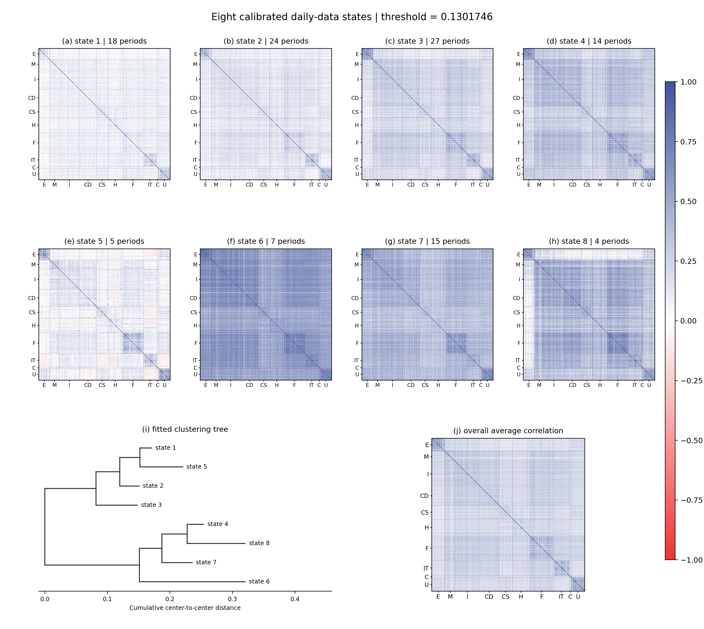
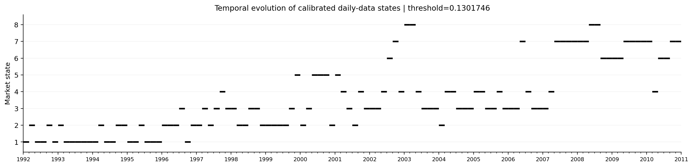

# Identifying financial market states

An independent Python reproduction and extension of the correlation based market state analysis in [Münnix et al., *Identifying States of a Financial Market* (Scientific Reports, 2012)](https://www.nature.com/articles/srep00644). This project cleans daily stock prices, builds market correlation matrices, groups time windows into states, and examines how those states change around periods of stress.

**Portfolio snapshot:** 300 stock files across 10 sectors were audited; 297 complete history stocks entered the default disjoint window analysis. The published threshold of `0.1465` produced **2 states** on the supplied dataset. A threshold calibrated on these data, `0.1301746`, produced **8 states** for comparison. The eight state result is a sensitivity analysis, not a reproduction of the paper's eight states at its published threshold.



## What I built

- A cleaning pipeline for dates, prices, duplicates, and stock coverage, retaining original input files unchanged.
- Daily arithmetic returns and 13 point local normalization, followed by correlation matrices for 42 trading day windows.
- A mean absolute matrix distance measure and adaptive top down state clustering, plus a fixed `k=8` comparison.
- Threshold sensitivity, cluster quality checks, sector level correlation views, a state timeline, and daily rolling analysis accelerated with Numba.

The full workflow is in [`munik/analysis/run_pipeline.py`](munik/analysis/run_pipeline.py). The paper focused notebook is [`notebooks/market_states_paper.ipynb`](notebooks/market_states_paper.ipynb); implementation notes and commands are in [`munik/analysis/README.md`](munik/analysis/README.md). The [seminar result notes](munik/analysis/seminar_results.md) document the data audit and the difference from the paper's reported result.

## Selected results

| Run | States | Mean silhouette | Interpretation |
| --- | ---: | ---: | --- |
| Published threshold `0.1465` | 2 | 0.278 | Outcome on the supplied data |
| Calibrated threshold `0.1301746` | 8 | 0.047 | Exploratory eight state comparison |

The calibrated eight state partition has a lower mean silhouette score. The supplied stock universe or preprocessing may differ from the original study, so the state count should not be presented as an exact reproduction. The notebook also compares daily rolling correlation structure and visualizes state evolution.



## Repository map

| Path | Contents |
| --- | --- |
| [`munik/analysis/`](munik/analysis/) | Pipeline, Numba routines, figure generation, verification script, and notes |
| [`notebooks/market_states_paper.ipynb`](notebooks/market_states_paper.ipynb) | Walkthrough with outputs cleared for publication |
| [`munik/analysis/notebook_paper_v2/`](munik/analysis/notebook_paper_v2/) | Selected figures and small result tables |
| [`munik/munik.pdf`](munik/munik.pdf) | Project report |

## Run locally

Install Python and the packages in `requirements.txt`:

```bash
python -m pip install -r requirements.txt
```

Place the stock CSVs in `munik/date set/pure/` and the trading calendar at `munik/date set/price/Date.mat`, then run:

```bash
python munik/analysis/run_pipeline.py
```

For data stored elsewhere, pass `--input-root` and `--calendar-mat`. The script writes generated files to `munik/analysis/output/` by default. See the [pipeline README](munik/analysis/README.md) for options and output descriptions.

## Data and scope

The raw stock files, large intermediate arrays, generated output folders, notebook checkpoints, and third party reference PDFs are omitted from Git. The published notebook has its saved outputs cleared and its local absolute path replaced. The repository includes selected final figures and summary tables so the work can be reviewed without the data. Full reproduction requires the original price files and calendar; the results above describe the supplied local dataset, not a universal market classification. The original local files remain in place.
